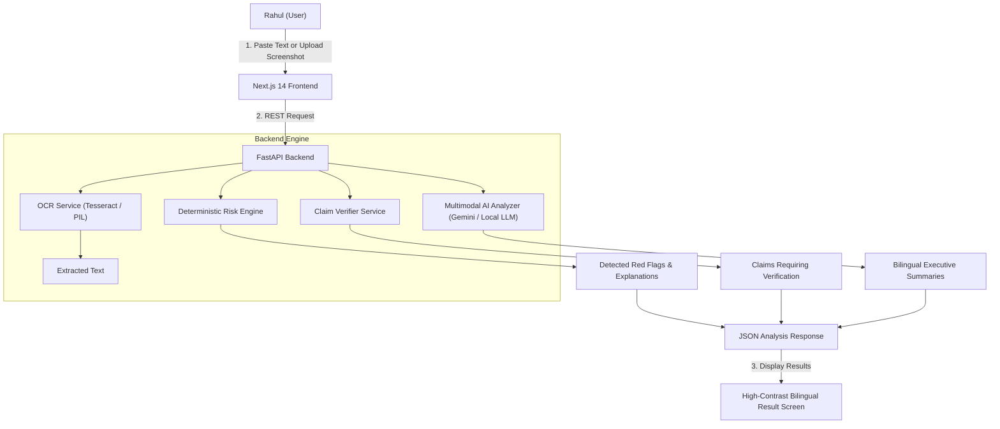

# SANGYAN System Architecture

## Overview
SANGYAN is built as a micro-layered, privacy-preserving risk analysis platform. It analyzes user-provided financial message text and screenshots to identify fraud indicators without storing user data.

## Key Components

### 1. Heuristic Risk Engine (`backend/app/services/risk_engine.py`)
- Evaluates 8 distinct fraud indicator categories using comprehensive regex patterns for English and Hindi.
- Computes a capped 0–100 Risk Assessment Score.
- Maps scores to Risk Levels: `Low` (0-30), `Medium` (31-65), `High` (66-100).

### 2. OCR Text Extraction (`backend/app/services/ocr.py`)
- Extracts text from uploaded WhatsApp/Telegram screenshots.
- Includes graceful fallback mechanisms if OCR binaries are missing.

### 3. Claim Verifier Service (`backend/app/services/verifier.py`)
- Validates domain URLs against known official portals (`sebi.gov.in`, `rbi.org.in`, `amfiindia.com`, recognized brokers).
- Flags suspicious typosquatting domains (e.g. `sebi-returns.xyz`).

### 4. Internationalization Layer (`frontend/src/lib/i18n.ts`)
- Provides instant client-side switching between English and Hindi.
- Modular design allows effortless expansion to Tamil, Telugu, Marathi, and Gujarati in future iterations.
